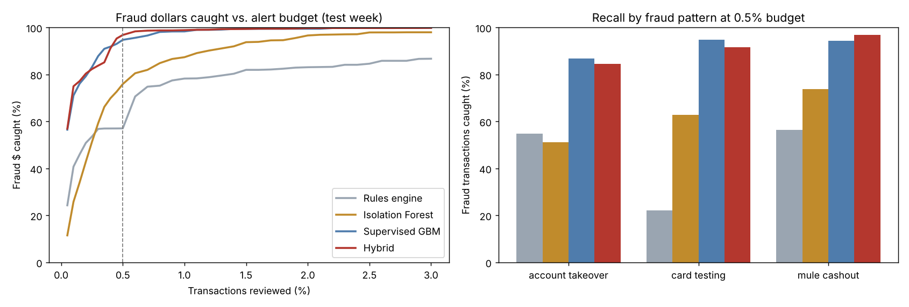

# Transaction Fraud Detection

Scores **1.2 million transactions** a month and sends the riskiest 0.5% to a fraud analyst queue.
Compares the detectors a fraud team actually runs (a **rules engine**, an unsupervised **Isolation
Forest**, a **supervised gradient-boosting** model, and a **hybrid** of all three) on what matters:
fraud dollars caught for a fixed review budget.

**[Project page with interactive alert-budget explorer](https://martinogie.github.io/transaction-fraud-detection/)**



## Results (test week, 324,037 transactions, 637 frauds worth $416,079)

Review budget: top 0.5% of transactions, $4 analyst cost per alert.

| Detector | PR-AUC | Precision | Recall | Fraud $ caught | Net savings |
|---|---|---|---|---|---|
| Rules engine | 0.125 | 0.16 | 0.40 | 57% | $230,977 |
| Isolation Forest | 0.244 | 0.24 | 0.61 | 76% | $309,532 |
| Supervised GBM | 0.585 | 0.36 | 0.92 | 95% | $387,821 |
| Hybrid | 0.540 | 0.35 | 0.90 | 97% | $396,442 |

Recall by fraud pattern at the same budget:

| Detector | Account takeover | Card testing | Mule cash-out |
|---|---|---|---|
| Rules engine | 55% | 22% | 56% |
| Isolation Forest | 51% | 63% | 74% |
| Supervised GBM | 87% | 95% | 94% |
| Hybrid | 85% | 92% | 97% |

What the numbers say:
- **Rules alone miss most card testing.** Fixed thresholds can't tell fraudsters' micro-charges from
  commuters' transit taps.
- **Isolation Forest needs no labels** and beats the rules, a good first line when confirmed fraud is scarce.
- **The supervised model wins on ranking** (PR-AUC 0.59), even though only
  1,011 of 1,545 training frauds were confirmed by the training cutoff.
- **The hybrid catches the most dollars** (97%) by adding rule hits and the anomaly score.
  Training weights each fraud by its amount, so the queue prioritises money at risk over count.
- Precision tops out near 0.39 here because only 0.20% of transactions are fraud while the
  queue holds 0.5%; the budget is sized for recall.

## Design choices

| Choice | Why |
|---|---|
| Point-in-time velocity features (10 min / 1 h / 24 h counts, spend vs. the account's own history, new device, foreign IP, small-charge bursts) | Fraud shows up as a change in behaviour, and features must not peek at the future |
| Train on days 1–20, 2-day gap, test on days 23–30 | Mimics deployment; the gap avoids leakage across the boundary |
| Labels only count if confirmed by the training cutoff | Chargebacks arrive 1–14 days late; ignoring this inflates offline results |
| Fixed alert budget, dollar recall and net savings | Analysts review a fixed number of cases a day; dollars matter more than counts |
| Legitimate look-alikes in the data (travellers on new devices abroad, transit micro-purchases, young accounts moving large sums) | Without them every method looks perfect |

## Quick start

```bash
pip install -r requirements.txt
python -m fraud.run                     # generate 1.2M transactions, train, evaluate -> reports/
python -m unittest discover -s tests    # 6 tests
python -m fraud.score --input day.csv --budget 0.005 --out alerts.csv
```

Featurising and scoring the full 1.2M-transaction month takes about 20 seconds on a laptop CPU.

## Data note

All data is synthetic, built with three known fraud patterns (account takeover, card testing,
mule cash-out) and realistic legitimate look-alikes, so each detector can be checked against the truth.

## How this was built

Built with AI-assisted coding (Claude). Modeling choices, validation and review are my own.

## License

MIT
